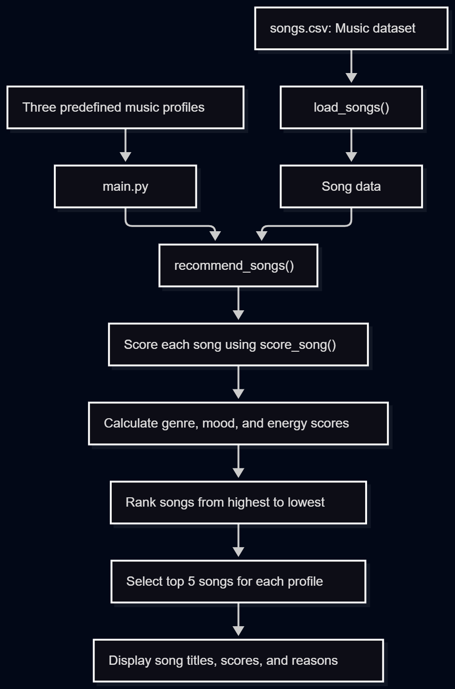

# MusicMatch — Applied AI Music Recommender

## Original Project (Modules 1–3)

My original project was the Music Recommender Simulation from CodePath AI110. The goal was to recommend songs based on a user's favorite genre, mood, and energy level. The program reads songs from a CSV file, scores each song, and displays the top five recommendations with explanations.

## Project Summary

MusicMatch is a Python-based music recommendation system that helps users discover songs based on their music preferences. It compares different songs and gives each one a score. This project shows how a simple recommendation algorithm can help people find music they might enjoy.

## Architecture Overview

My system uses three example music profiles and a dataset of 18 songs. The program loads the songs from a CSV file, compares them with each profile, and calculates scores based on genre, mood, and energy. It then ranks the songs and displays the top five recommendations.

I also use testing and human review to check whether the recommendations make sense and identify areas for improvement.

The architecture diagram is saved in `diagrams/architecture.mmd`.



## Setup Instructions

To run this project:

1. Clone the GitHub repository.
2. Open the project folder in VS Code.
3. Create a Python virtual environment.
4. Activate the environment.
5. Install the required packages.
6. Run the music recommender.

Commands for Windows PowerShell:

```powershell
python -m venv .venv
.\.venv\Scripts\Activate.ps1
python -m pip install -r requirements.txt
python -m src.main
```

The program will display the top five recommendations for each example music profile.

## Sample Interactions

These examples are from my original scoring system, before the weight-shift experiment.

### Example 1: High-Energy Pop

**Input:** Genre = pop, Mood = happy, Energy = 0.9

**Output:**

```text
1. Sunrise City (Score: 3.92)
   Reasons: genre match (+1.5), mood match (+1.5),
   energy closeness (+0.92)
```

### Example 2: Chill Lofi

**Input:** Genre = lofi, Mood = chill, Energy = 0.2

**Output:**

```text
1. Library Rain (Score: 3.85)
   Reasons: genre match (+1.5), mood match (+1.5),
   energy closeness (+0.85)
```

### Example 3: Deep Intense Rock

**Input:** Genre = rock, Mood = intense, Energy = 0.85

**Output:**

```text
1. Storm Runner (Score: 3.94)
   Reasons: genre match (+1.5), mood match (+1.5),
   energy closeness (+0.94)
```

These examples show that changing the music preferences can lead to different recommendations.

## Design Decisions

I chose to use genre, mood, and energy because they are simple features that describe a song's style and feeling.

I used a scoring system because it is easy to understand and explain. The program also shows the reasons behind each recommendation.

One trade-off is that the system does not learn from real listening habits. It depends on the information already stored in the dataset.

## Testing Summary

### Automated Testing Results

I used pytest to check whether my music recommender works correctly. I ran 8 tests, and all 8 passed.

| Test | Result |
|---|---|
| Loading 18 songs from CSV | Pass |
| Genre scoring | Pass |
| Mood scoring | Pass |
| Energy similarity | Pass |
| Sorting recommendations by score | Pass |
| Returning the requested number of songs | Pass |
| Two existing tests | Pass (2 tests) |

Summary: 8 out of 8 tests passed, with no failures. The tests showed that my program correctly loads songs, calculates scores, and ranks recommendations. I also learned that running tests with python -m pytest worked better in my environment than using pytest directly.

## Reflection

This project helped me understand how recommendation systems use information to make suggestions. I learned that changing the scoring rules can affect which songs appear first. It also taught me how important testing is when building an AI-related system.

For a more detailed discussion of responsible AI, limitations, and my use of AI coding tools, see [Model Card](model_card.md).